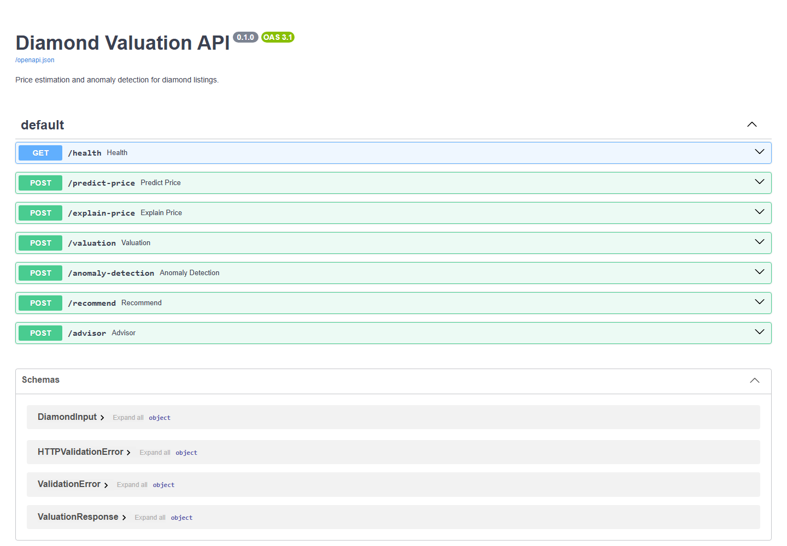

# Diamond Price Prediction

This is my Task 3 project for studying diamond prices. The main question is:
given a diamond's weight, cut, color, clarity and measurements, how close can a
model get to its listed price?

## Dataset and cleaning

The project uses the public
[diamonds dataset](https://github.com/mwaskom/seaborn-data/blob/master/diamonds.csv).
It has 53,940 rows and the fields carat, cut, color, clarity, depth, table, x,
y, z and price. See [DATA_DICTIONARY.md](DATA_DICTIONARY.md) for field meanings.

The cleaning step removes duplicate rows, rows missing required values, records
with non-positive dimensions, and records outside the selected ranges for
carat, depth, table and price. This leaves 53,774 rows.

## Analysis and features

The EDA report includes the raw and cleaned row counts, missing values,
duplicates, invalid dimensions, numeric summaries, price distribution,
carat-versus-price, cut-versus-price, price per carat and a correlation chart.
Price per carat is calculated as `price / carat` for analysis only. It is not
passed into the price model because it is calculated using the value being
predicted.

The model pipeline adds diamond volume (`x * y * z`), an `x * y` area proxy,
ordinal scores for cut, color and clarity, a combined quality score and a
carat-to-volume ratio. The raw categories are also one-hot encoded.

## Models and evaluation

The data is split into 80% training and 20% test data using random state 42.
Three-fold cross-validation is run on the training portion. The test portion
is held back for the final model comparison.

Results from this run (CV figures are means across three folds):

- **Linear Regression:** test MAE $714.33, RMSE $1,083.65, R² 0.9257;
  CV MAE $721.14, RMSE $1,410.62, R² 0.8616.
- **Random Forest:** test MAE $268.14, RMSE $541.89, R² 0.9814;
  CV MAE $277.10, RMSE $565.98, R² 0.9799.
- **XGBoost:** test MAE $261.53, RMSE $512.52, R² 0.9834;
  CV MAE $270.42, RMSE $543.50, R² 0.9814.

The model is selected using its mean CV RMSE, not the test results. XGBoost
had the lowest mean CV RMSE in this run and is saved as the price model.
The CV values are averages over three training folds; the test metrics come
from the separate held-out test split. Training also writes actual-versus-
predicted, residual, permutation-importance and SHAP reports under `reports/`.

## Workflow

The project reads the CSV, cleans the records and prepares the model features.
It then compares three models using cross-validation on the training data and
reports their results on a separate test split. The selected model is saved
and used by both the Streamlit dashboard and the FastAPI service. EDA and
model-diagnostic reports are saved separately. The diamond advisor retrieves
relevant notes from its local knowledge file and can optionally use an
OpenAI-compatible service to write an answer.

## Other project parts

- **Price estimates:** the dashboard and API estimate a price and compare it
  with an optional listed price. These are model estimates, not appraisals.
- **Anomaly detection:** Isolation Forest flags records unlike the training
  data. A flag does not mean the listing is fraudulent.
- **Market groups:** KMeans groups diamonds using carat, quality scores and
  price. The dashboard labels the groups by their median prices.
- **Explainability:** permutation importance shows how test error changes when
  a feature is shuffled. SHAP shows average and per-diamond contributions to a
  prediction. These explain model behaviour, not cause and effect.
- **Diamond advisor:** TF-IDF retrieves notes from
  `data/diamond_knowledge.json`, including links to GIA's carat, cut, color and
  clarity guides. If configured, an OpenAI-compatible chat-completions API
  uses the retrieved notes to draft an answer. Without an API key, the app
  returns the matching note.
- **Tracking:** MLflow records model metrics locally in `mlflow.db`, which is
  ignored by Git.

## Running it on Windows

From the project directory, create the environment and install requirements
if you have not already done so:

```powershell
python -m venv .venv
& ".\.venv\Scripts\python.exe" -m pip install -r requirements.txt
```

Train the models and create the reports:

```powershell
& ".\.venv\Scripts\python.exe" src/train.py
& ".\.venv\Scripts\python.exe" src/eda_report.py
```

Start the dashboard:

```powershell
& ".\.venv\Scripts\python.exe" -m streamlit run app.py
```

Open `http://localhost:8501`.

In another terminal, start the API:

```powershell
& ".\.venv\Scripts\python.exe" -m uvicorn api.main:app --reload
```

Open `http://127.0.0.1:8000/docs`.

To enable generated advisor answers, set these variables in the terminal
before starting the app. Use a provider and model supported by your API:

```powershell
$env:OPENAI_API_KEY = "your-key"
$env:OPENAI_BASE_URL = "https://api.openai.com/v1"
$env:OPENAI_MODEL = "gpt-4o-mini"
```

Keep the key out of source files and GitHub.

## API routes

- `GET /health`
- `POST /predict-price`
- `POST /explain-price`
- `POST /valuation`
- `POST /anomaly-detection`
- `POST /recommend`
- `POST /advisor`

## Screenshot

The API documentation page is shown below. The dashboard and API can also be
started locally using the commands above.



## Tests

Run the automated tests with:

```powershell
& ".\.venv\Scripts\python.exe" -m pytest -q
```
